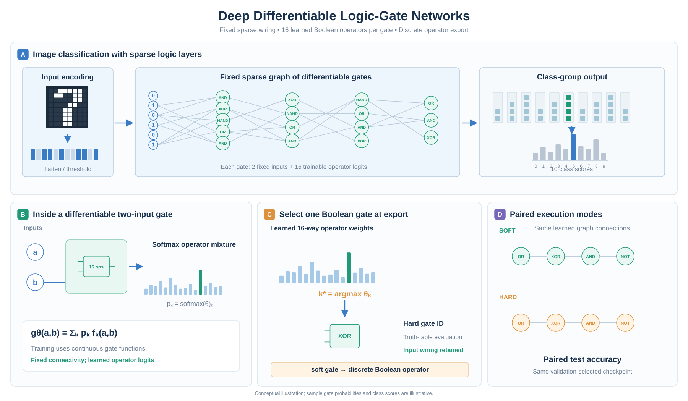

# DLGN: Differentiable Logic-Gate Networks

**English** | [简体中文](README.zh-CN.md)

**Learn with continuous gates. Execute with discrete logic.**

An independent PyTorch implementation and reproduction study of [Deep Differentiable Logic Gate Networks](https://arxiv.org/abs/2210.08277). The contributions below describe this repository's implementation and evaluation scope; the underlying learning paradigm is attributed to the original work.

## Abstract

Learning a classifier built from Boolean operators requires a bridge between continuous optimization and discrete execution. DLGN implements that bridge with sparsely connected two-input gates: training optimizes a differentiable mixture over 16 Boolean operators, and export assigns one operator to each gate. This repository brings soft training, discrete export, and paired evaluation into a common PyTorch workflow. A representative MNIST model achieves **98.15% soft and 97.86% hard test accuracy**. On CIFAR-10, the reported large configuration reaches **55.44% hard accuracy**, with a **0.14 percentage-point** soft-to-hard difference. These paired results characterize the transfer from learned operator mixtures to executable discrete gates.

## Contributions

- **An explicit train-to-logic path.** Fixed sparse connectivity and learnable operator logits connect gradient-based training to inspectable, discrete gate assignments.
- **Paired evaluation of the exported model.** Soft and hard modes are reported together, so the deployed gate choices are assessed directly alongside their training-time relaxation.
- **A modular research implementation.** Separate data embeddings, gate operators, network layers, training, evaluation, and export provide a foundation for [Conv-DLGN](https://github.com/13710833172/Conv-DLGN) and [Logic-SNN](https://github.com/13710833172/Logic-SNN).

## Methodology



*Figure 1. A fixed graph learns operator choices. Soft optimization and hard execution share the connectivity; export replaces each operator mixture with its highest-logit Boolean operator.*

For a gate with inputs $a,b$, the differentiable output is

$$g(a,b)=\sum_{k=0}^{15}\operatorname{softmax}(\theta)_k f_k(a,b),\qquad k^*=\arg\max_k\theta_k.$$

Here $f_k$ is a continuous extension of a two-input Boolean operator. Each soft gate stores 16 logits; the exported gate stores an operator identity and its input connections. Images are flattened or embedded with thresholds, processed by sparse logic layers, and aggregated by class-group sums. See [gate layers](src/models/logic_layer.py), [Boolean operators](src/ops/logic_ops.py), and [hard export](src/discretize.py).

## Experiments

**Question: does the learned classifier retain its accuracy when operator mixtures become discrete choices?** Table 1 pairs the two execution modes for each reported configuration.

| Dataset / configuration | Soft test accuracy | Hard test accuracy | Soft − hard (pp) |
| --- | ---: | ---: | ---: |
| MNIST / normal | 98.15% | **97.86%** | 0.29 |
| CIFAR-10 / small | 48.80% | 47.91% | 0.89 |
| CIFAR-10 / large | 55.58% | **55.44%** | **0.14** |

*Table 1. Representative completed local configurations; pp denotes percentage points. Each row pairs soft evaluation and hard export of the same selected model. Rows have different configurations and training settings.*

**Takeaway.** The MNIST result demonstrates classification with discrete gate choices at 97.86% accuracy. The CIFAR-10 large result provides a second example of close agreement between soft and hard execution, with a 0.14 pp difference. The table evaluates conversion within each model; it does not assign the differences between configurations to any single architectural factor.

**Protocol.** Checkpoints are selected by validation soft accuracy and then evaluated on the test split. Values summarize individual completed configurations, rather than an average across independent seeds. The MNIST loader uses continuous flattened pixels in training and thresholded pixels in validation/test; CIFAR-10 uses configuration-specific threshold embeddings. This input protocol is part of the implementation being evaluated. The reported measurements concern classification and conversion in PyTorch; hardware latency and energy are separate evaluation dimensions. Datasets, checkpoints, and raw experiment histories are maintained outside the repository.

## Getting started

```bash
python3 -m venv .venv
source .venv/bin/activate
pip install -r requirements.txt

# Full training configuration.
python src/train.py --config configs/mnist_normal_paper.yaml
```

The example starts a new run. Its outcome depends on the configuration and training environment; the table summarizes previously completed configurations. Use the generated checkpoint path for evaluation and export:

```bash
python src/evaluate.py --checkpoint path/to/checkpoint.pt
python src/discretize.py --checkpoint path/to/checkpoint.pt
python -m pytest tests/test_logic_ops.py tests/test_connectivity.py tests/test_output_grouping.py -v
```

## Repository guide

| Entry | Purpose |
| --- | --- |
| [src/data/](src/data/) | Dataset loading and embedding; downloaded datasets belong in root `/data/` |
| [src/models/](src/models/), [src/ops/](src/ops/) | Soft/hard networks and Boolean operators |
| [configs/](configs/) | MNIST and CIFAR-10 configurations |
| [scripts/](scripts/) | Resource probes and plotting utilities |
| [REFERENCE_NOTES.md](REFERENCE_NOTES.md) | Attribution and implementation scope |

## Conclusion

DLGN makes the transition from differentiable learning to discrete logic explicit: a fixed sparse graph, learned Boolean operator choices, and paired measurements of the resulting classifier.
