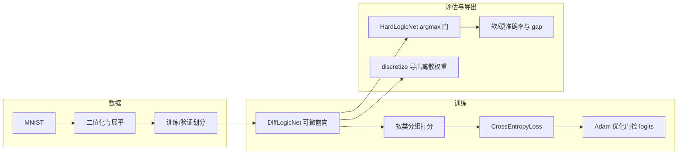

# 深度可微逻辑门网络（Deep Differentiable Logic Gate Network）

基于纯 PyTorch 的可训练逻辑门网络，用于 **MNIST**（像素二值化展平）与 **CIFAR-10**（论文向 RGB 阈值二值嵌入，见下）等二值向量输入的分类。网络**不学习全连接权重**，而是：每层固定随机二入连接 + 每个神经元在 **16 种二元布尔算子** 上做 **softmax 混合**（训练），训练结束后对门控做 **argmax 离散化** 得到硬逻辑网络（推理/评估）。

---

## 一、整体流程概览




1. **数据**：从 torchvision 读取 MNIST，像素归一化到 `[0,1]` 后按阈值二值化，展平为 784 维；从官方训练集按种子划分出训练集与验证集，测试集独立。
2. **可微训练**：`DiffLogicNet` 逐层前向，每层神经元对两个输入做 16 个实值算子输出，再按 `softmax(门控 logits)` 加权求和；最后一层输出按 10 类均匀分组求和并除以 `tau` 得到类别 logits，用交叉熵训练**仅门控 logits**（连接为 buffer，不更新）。
3. **训练中监控**：每个 epoch 记录训练损失、验证集软模型准确率、测试集软/硬准确率与离散化 gap；并从验证集取一批样本统计每层门控熵、最大门概率、激活均值/标准差；可选按间隔做逐层 soft–hard 一致性诊断。
4. **检查点**：验证集软准确率创新高时保存 `best_model.pt`（含 `model_state_dict`、`optimizer_state_dict`、完整 `config`、`connectivity_seed` 等）。
5. **离散化**：`discretize.py` 从软模型检查点读取权重，对每层 `argmax` 得到 `gate_ids`，与 `connectivity`、种子、`meta` 一并保存为 `*_discrete.pt`。
6. **独立评估**：`evaluate.py` 加载检查点，重建软模型并构造当前 argmax 对应的硬网络，在测试集上分别报告软/硬准确率与 gap。

---

## 二、项目目录与文件说明

下列为仓库内**主要**文件与职责（`logs/`、`checkpoints/`、`data/` 等为运行生成目录，不强制纳入版本控制）。

### 根目录


| 文件                 | 内容说明                                                       |
| ------------------ | ---------------------------------------------------------- |
| `requirements.txt` | Python 依赖：`torch`、`torchvision`、`pyyaml`、`pytest` 及最低版本约束。 |
| `README.md`        | 本说明文档（中文）：结构、流程、配置与命令。                                     |


### `configs/`


| 文件                       | 内容说明                                                                                                                                        |
| ------------------------ | ------------------------------------------------------------------------------------------------------------------------------------------- |
| `mnist_debug.yaml`        | **调试/冒烟**：3 层、每层 260 个神经元（260 可被 10 整除以便分组）、`gate_init: zeros`（均匀 softmax）、5 epoch、检查点目录 `checkpoints/`、`log_soft_hard_consistency: false`。 |
| `mnist_small_paper.yaml`  | **论文向小规模**：6 层、每层 8000 神经元、`gate_init: normal`、`tau: 10.0`、`beta: 0.0`、Adam `lr: 0.01`、`batch_size: 100`、`max_epochs: 200`、二值阈值 `0.5`、检查点 `checkpoints/paper_small/`。 |
| `mnist_normal_paper.yaml` | **论文向 MNIST normal（宽网）**：6 层、每层 **64000** 神经元（门控 logits 论文口径 **384000**）、`tau = 1/0.03`（YAML 中为 `33.333333333333336`）、`beta: 0.0`、Adam `lr: 0.01`、`batch_size: 100`、`max_epochs: 200`、二值阈值 **0.5**、检查点 `checkpoints/paper_normal/`。显存占用极大，训练前请先运行 `scripts/check_mnist_normal_feasibility.py`。 |
| `cifar10_small_paper.yaml` | **论文向 CIFAR-10 small**：4 层、每层 **12000** 神经元（论文口径 **# Param. = 48000**）、`data.cifar10_embedding: paper_small`、输入维 **9216**、`tau = 1/0.03`、检查点 `checkpoints/cifar10_small_paper/`。可先运行 `scripts/check_cifar10_small_feasibility.py`。 |
| `cifar10_large_paper.yaml` | **论文向 CIFAR-10 large**：5 层、每层 **256000** 神经元（论文口径 **# Param. = 1280000**）、`data.cifar10_embedding: paper_large`、输入维 **95232**（31 阈值/通道，见下）、`tau = 1/0.01`（YAML `100.0`）、检查点 `checkpoints/cifar10_large_paper/`。**显存需求极高**；务必先运行 `scripts/check_cifar10_large_feasibility.py`，OOM 时仓库**不会**自动改小模型。 |


各配置包含：`model`（层数、宽度、`input_dim`、类别数、门控初始化）、`data`（`dataset`、`cifar10_embedding`（CIFAR 时）、`data_dir`、验证集大小、划分种子；MNIST 另有二值阈值）、`training`（Adam 学习率、batch、epoch、device）、`output`（分组聚合的 `tau`/`beta`）、`logging`、`checkpoint.seed`（连通性基准种子）。

**CIFAR-10 二值嵌入（本仓库论文向约定）**  

- **Small（`paper_small`，默认）**：`ToTensor()` → `[0,1]`。每通道、每像素三个严格阈值 **0.25、0.5、0.75**（`float(value > t)`）。展平顺序：**通道 R,G,B → 阈值 → 行优先 (h,w)**。维度 **`32×32×3×3 = 9216`**。  
- **Large（`paper_large`）**：**不要**使用 small 的三阈值嵌入。颜色通道分辨率 **32**：每通道、每像素对 **`i/32`（`i = 1, …, 31`）** 各一个二值指示量 **`value > i/32`**，共 **31** 个二进制特征/通道/像素。展平顺序同上。维度 **`32×32×3×31 = 95232`**。  

无额外数据增强、无 ImageNet 式标准化。实现与常量见 `src/data/cifar10.py`。

### `src/` 入口脚本


| 文件              | 内容说明                                                                                                                                                                                                                                                                     |
| --------------- | ------------------------------------------------------------------------------------------------------------------------------------------------------------------------------------------------------------------------------------------------------------------------ |
| `train.py`      | 主训练脚本：解析 `--config` YAML；`data.dataset` 经 `get_data_loaders` 构建 MNIST 或 CIFAR-10；校验 `input_dim` 与分组可整除；实例化 `DiffLogicNet` 与 Adam；训练循环、`final_test.json`、`mnist_table4_summary.*`（数据集名写入 Markdown 标题）、`cuda_memory.csv`（CUDA）等与 MNIST 流程一致。 |
| `evaluate.py`   | 从检查点读取 `config`，按 `data.dataset` 重建测试 DataLoader，其余与 MNIST 相同。                                                                                                                                                                                          |
| `discretize.py` | 加载训练检查点，重建 `DiffLogicNet` 并加载权重；导出每层 `gate_ids`（argmax）、`connectivities`、`connectivity_seed` 与 `meta`（架构与 `tau`/`beta` 等）到 `*_discrete.pt`；可选 `--out` 指定路径。                                                                                                              |


### `src/data/`


| 文件            | 内容说明                                                                                                                                                                                                 |
| ------------- | ---------------------------------------------------------------------------------------------------------------------------------------------------------------------------------------------------- |
| `mnist.py`    | `get_mnist_loaders`：下载/读取 MNIST，`ToTensor` → 阈值二值化 → 展平为 784；用 `random_split` 与 `data_seed` 从 60000 条训练图像中切出固定验证集大小；返回 `(train_loader, val_loader, test_loader)`，`pin_memory` 等 DataLoader 参数便于 GPU。 |
| `cifar10.py`  | `get_cifar10_loaders(..., embedding=...)`：`paper_small` → **9216** 维；`paper_large` → **95232** 维（31 阈值/通道）。划分与 MNIST 相同。常量 `CIFAR10_PAPER_BINARY_INPUT_DIM`、`CIFAR10_PAPER_LARGE_INPUT_DIM`。 |
| `loaders.py`  | `get_data_loaders`；`validate_model_data_config`；`cifar10_embedding_mode` 解析 `data.cifar10_embedding`。 |
| `__init__.py` | 包标识（空）。                                                                                                                                                                                              |


### `src/ops/`


| 文件             | 内容说明                                                                                                                                                                       |
| -------------- | -------------------------------------------------------------------------------------------------------------------------------------------------------------------------- |
| `logic_ops.py` | **16 个实值逻辑算子**的向量化实现 `compute_all_16_ops(a, b)`（输出最后一维为 16，顺序固定）；`build_truth_table()` 生成 `[16,2,2]` 整型真值表供硬推理；`hard_logic_lookup` 对批量 `(a,b,gate_ids)` 做查表。二值输入下与经典真值表一致。 |
| `__init__.py`  | 包标识（空）。                                                                                                                                                                    |


### `src/models/`


| 文件                    | 内容说明                                                                                                                                                                                                                                                                 |
| --------------------- | -------------------------------------------------------------------------------------------------------------------------------------------------------------------------------------------------------------------------------------------------------------------- |
| `logic_layer.py`      | `DiffLogicLayer`：注册 `connectivity` buffer（可由外部张量或 `connectivity_seed` 生成）；可学习参数 `gate_logits`（形状 `[num_neurons, 16]`），`gate_init` 为 `zeros` 或 `normal`；前向为 gather 两路输入 → `compute_all_16_ops` → softmax 加权求和。                                                        |
| `logic_net.py`        | `DiffLogicNet`：`ModuleList` 堆叠多层 `DiffLogicLayer`；第一层输入维 784，之后每层输入维等于上一层宽度；每层连通性种子为 `connectivity_seed + layer_index * 1000003`；提供 `forward`、`forward_with_activations`（末层输出、各层激活、各层门概率）、`connectivity_tensors`、`discretized_gate_ids`、`from_checkpoint_state` 类方法。 |
| `hard_logic_layer.py` | `HardLogicLayer`：固定 `connectivity` 与离散 `gate_ids` buffer；预计算并注册 `truth_table`；前向对输入取整到 {0,1}，用 `hard_logic_lookup` 得到 {0,1} 浮点输出。                                                                                                                                    |
| `hard_logic_net.py`   | `HardLogicNet`：按层列表构造多个 `HardLogicLayer`；`forward` 整网前向；`forward_layerwise`（`@torch.no_grad()`）返回每层激活列表，供诊断；`from_soft_model` 从软模型复制连接并默认用当前 logits 的 argmax 作为门 ID。                                                                                                 |
| `__init__.py`         | 包标识（空）。                                                                                                                                                                                                                                                              |


### `src/utils/`


| 文件                   | 内容说明                                                                                                                                                                                                              |
| -------------------- | ----------------------------------------------------------------------------------------------------------------------------------------------------------------------------------------------------------------- |
| `connectivity.py`    | `build_connectivity(input_dim, output_dim, seed)`：用 `torch.Generator` 与 `torch.randint` 为每个输出神经元采样两个父节点索引，形状 `[output_dim, 2]`，全层随机、可复现。                                                                          |
| `output_grouping.py` | `compute_class_scores(outputs, num_classes, tau, beta)`：将 `[B, D]` 重塑为 `[B, num_classes, group_size]`，对最后一维求和再 `sum/tau + beta`，得到分类 logits（要求 `D` 能被类别数整除）。                                                      |
| `metrics.py`         | `gate_entropy`、`layer_gate_stats`（层内平均熵与平均最大门概率）、`activation_mean_std`、`collect_soft_layer_stats`（对一批输入跑 `forward_with_activations` 并汇总）、`soft_hard_layerwise_agreement`（逐层比较软硬激活在容差内的一致比例）、`discretization_gap`。 |
| `__init__.py`        | 包标识（空）。                                                                                                                                                                                                           |


### `tests/`


| 文件                              | 内容说明                                                                               |
| ------------------------------- | ---------------------------------------------------------------------------------- |
| `conftest.py`                   | 将项目根目录加入 `sys.path`，保证 `import src.`* 在 pytest 下可用。                                |
| `test_logic_ops.py`             | 16 算子在四种二值输入下的真值表校验；随机 `[0,1]` 输入的有界性与有限性；`build_truth_table` 与手工期望一致；多维 shape 检查。 |
| `test_connectivity.py`          | 同种子同形状连通性完全一致；不同种子生成不同张量。                                                          |
| `test_output_grouping.py`       | 分组与 `tau`/`beta` 公式校验；不可整除时抛出 `ValueError`。                                        |
| `test_discretization.py`        | 单层 `gate_logits` 的 `argmax` 与逐元素手工 argmax 一致。                                      |
| `test_soft_hard_consistency.py` | 将门控 logits 设为近似 one-hot（强推向某一算子），软网与硬网在二值输入上输出接近。                                  |
| `__init__.py`                   | 包标识（空）。                                                                            |


### `src/__init__.py`

包标识（空）。

---

## 三、模型与数据要点（与实现对齐）

- **神经元**：每层每个神经元恰有两个输入，索引来自上一层（或输入层）**全局随机**采样，初始化后固定为 buffer。
- **可训练部分**：每个神经元 16 维 `gate_logits`，训练时使用标准 `softmax`（无额外温度）。
- **分类头**：最后一层宽度不必等于 10；将 `neurons_per_layer` 个输出**均匀切成 10 组**，组内求和后除以 `tau` 并加 `beta`，再送入 `CrossEntropyLoss`。
- **硬推理**：对每个神经元取 `argmax` 得到单一算子 ID，用 `[16,2,2]` 真值表向量化查表；适合二值输入；训练中评估硬网时即用当前 argmax 构造 `HardLogicNet`。

---

## 四、环境与常用命令

在项目根目录执行（建议先创建虚拟环境）。**PyTorch 与 torchvision 需成对安装**；`requirements.txt` 已固定为 `torch==2.5.1` + `torchvision==0.20.1`，避免 `pip` 拉到过新 torch 而找不到匹配的 `torchvision` 轮子。

### 使用国内镜像加速 pip（可选）

**1）单次命令指定镜像**（不改全局配置）：

```bash
# 常用：清华 PyPI 镜像
pip install -r requirements.txt -i https://pypi.tuna.tsinghua.edu.cn/simple --trusted-host pypi.tuna.tsinghua.edu.cn
```

**2）GPU 版 PyTorch**：官方 CUDA 轮子托管在 `download.pytorch.org`，国内有时较慢。可**先试**用镜像装同一版本（清华等镜像会同步常见 `torch`/`torchvision` 轮子）：

```bash
pip install torch==2.5.1 torchvision==0.20.1 -i https://pypi.tuna.tsinghua.edu.cn/simple --trusted-host pypi.tuna.tsinghua.edu.cn
```

若镜像上暂时没有对应 CUDA 轮子，再改用官方索引（或查阅 [清华大学开源软件镜像站 — PyTorch 帮助](https://mirrors.tuna.tsinghua.edu.cn/help/pytorch/) 按说明选择 `cu118` / `cu124` 等组合）。

**GPU（推荐）**：按 [PyTorch 官网](https://pytorch.org/get-started/locally/) 选择 CUDA 版本后安装，例如 CUDA 12.4 索引：

```bash
cd /data/linan/MPhil_1/differentiable_logic_gate
pip install torch==2.5.1 torchvision==0.20.1 --index-url https://download.pytorch.org/whl/cu124
pip install "pyyaml>=6.0" "pytest>=7.0"
```

**CPU 或一次性安装文件内全部依赖**：

```bash
cd /data/linan/MPhil_1/differentiable_logic_gate
pip install -r requirements.txt

# 单元测试
python -m pytest tests/ -v

# 调试训练（快速冒烟）
python src/train.py --config configs/mnist_debug.yaml

# 论文向小规模（6×8000，检查点 checkpoints/paper_small/）
python src/train.py --config configs/mnist_small_paper.yaml

# 论文向 MNIST normal（6×64000，检查点 checkpoints/paper_normal/；请先可行性检查）
python scripts/check_mnist_normal_feasibility.py
python src/train.py --config configs/mnist_normal_paper.yaml

# 论文向 CIFAR-10 small（4×12000，检查点 checkpoints/cifar10_small_paper/；建议先冒烟）
python scripts/check_cifar10_small_feasibility.py
python src/train.py --config configs/cifar10_small_paper.yaml

# 论文向 CIFAR-10 large（5×256000，检查点 checkpoints/cifar10_large_paper/；极易 OOM，必须先可行性脚本）
python scripts/check_cifar10_large_feasibility.py
python src/train.py --config configs/cifar10_large_paper.yaml

# 从训练检查点导出离散门控与连接 (可选；路径换成你的 best_model.pt)
python src/discretize.py --checkpoint checkpoints/paper_small/best_model.pt
python src/discretize.py --checkpoint checkpoints/paper_normal/best_model.pt
python src/discretize.py --checkpoint checkpoints/cifar10_small_paper/best_model.pt
python src/discretize.py --checkpoint checkpoints/cifar10_large_paper/best_model.pt

# 在测试集上评估软模型与 argmax 硬模型 (可选)
python src/evaluate.py --checkpoint checkpoints/paper_small/best_model.pt
python src/evaluate.py --checkpoint checkpoints/paper_normal/best_model.pt
python src/evaluate.py --checkpoint checkpoints/cifar10_small_paper/best_model.pt
python src/evaluate.py --checkpoint checkpoints/cifar10_large_paper/best_model.pt

# 训练 CSV 可视化（需 matplotlib；参数为一次 run 的目录或其中的 train_log.csv）
python scripts/plot_training_log.py logs/run_20260413_033903
python scripts/plot_training_log.py logs/run_20260413_033903 -o figures/epoch200
```

后台训练示例：`nohup python src/train.py --config configs/mnist_small_paper.yaml > logs/paper_train_nohup.out 2>&1 &`

**Table 4 汇总（文件名仍为 `mnist_table4_summary.*`，各数据集共用）**  
- **`mnist_normal_paper.yaml`**：**Model** **Diff Logic Net**，**# Param.** / **OPs** **384000** / **384K**。  
- **MNIST / CIFAR-10 small**（6×8000 / 4×12000）：**Diff Logic Net (small)**，**48000** / **48K**。  
- **`cifar10_large_paper.yaml`（5×256000）**：**Diff Logic Net (large)**，**1280000** / **1.28M**。  
- **FLOPs** 均为 `-`。**T. [GPU]** 为纯 PyTorch `HardLogicNet` **全测试集**前向计时（**非**论文优化后端）。Markdown 标题含 **MNIST** / **CIFAR-10**。CUDA 训练可有 **`cuda_memory.csv`** 与 `cuda_peak_*`。

---

## 五、训练产物说明

每次运行会在 `logs/run_<时间戳>/` 下写入当次日志与测试汇总；`run_summary.json` 记录本 run 各产物路径。

| 路径/类型                           | 说明                                                                                                                             |
| ------------------------------- | ------------------------------------------------------------------------------------------------------------------------------ |
| `checkpoints/.../best_model.pt` | 当前验证集最优软模型；含 `model_state_dict`、`optimizer_state_dict`、`epoch`、`best_val_acc`、完整训练 `config`、`config_path`、`connectivity_seed`。 |
| `checkpoints/.../*_discrete.pt` | `discretize.py` 生成；含 `connectivities`、`gate_ids_per_layer`、`connectivity_seed`、`meta`。                                         |
| `logs/run_*/train_log.csv`       | 每 epoch 一行：训练损失、验证软/硬准确率、gap、学习率、epoch 用时等。                                                                                    |
| `logs/run_*/layer_stats.csv`     | 每层门控熵、最大门概率、激活均值/方差。                                                                                                                |
| `logs/run_*/final_test.json`     | 训练结束后用最佳检查点在测试集上的软/硬准确率及 gap。                                                                                                        |
| `logs/run_*/run_summary.json`    | 指向本 run 的 CSV、JSON、Table4 汇总、离散 bundle 等路径。                                                                                              |
| `logs/run_*/mnist_table4_summary.*` | Table 4 风格单行 CSV/Markdown（含 Model、Acc.、T. [GPU]、Train Time 等）。                                                                            |
| `logs/run_*/cuda_memory.csv`     | 仅 **CUDA** 训练时写入：每 epoch 的 `peak_allocated_gib` / `peak_reserved_gib`（该 epoch 内峰值）。                                                      |


---

## 六、注意事项与已知问题

1. **`mnist_normal_paper.yaml` 显存**：6×64000、batch 100 时单步前向/反传与 Adam 状态体积极大；**能否跑满 200 epoch 取决于 GPU 显存与驱动**。务必先运行 `python scripts/check_mnist_normal_feasibility.py`；若 OOM，本项目**不会**自动改小 batch 或宽度，请在**自行复制**的 YAML 中显式修改 `training.batch_size` 等参数。  
2. **`cifar10_small_paper.yaml`（4×12000）**：建议先运行 `python scripts/check_cifar10_small_feasibility.py`。OOM 时不会自动改 YAML。  
3. **`cifar10_large_paper.yaml`（5×256000）**：单层 batch 内中间张量极宽，**多数单机 GPU 在 batch 100 下会 OOM**。必须先运行 `python scripts/check_cifar10_large_feasibility.py`；若失败，**不要**指望本仓库静默改配置——需在**自行复制**的 YAML 中显式减小 `batch_size` 或宽度。  
4. **`soft_hard_layerwise_agreement`**：`DiffLogicNet.forward_with_activations` 的返回顺序为 `(final_out, per_layer_acts, per_layer_probs)`，须用 `_, soft_acts, _` 解包每层激活；错误解包会导致与硬网层数不一致。见 `src/utils/metrics.py`。
5. 评估与训练使用的数据预处理参数（`dataset`、`cifar10_embedding`、MNIST 阈值、划分种子、batch 大小）需与检查点内 `config` 一致；`evaluate.py` 从检查点读取 `config`，避免手动不一致。
6. **T. [GPU]**（Table 4 汇总与 `table4_summary`）：为纯 PyTorch 硬网在 GPU 上的 batch 前向计时，**不是**论文中的 C/CUDA 优化或 int64 打包推理后端。

---

## 七、说明

- DiffLogicLayer
每个神经元有 16 个 gate_logits
输出是 16 个实值门结果的加权和
输出是连续值 [0,1]
- HardLogicLayer
每个神经元只有一个 gate_id
输出是对应逻辑门的真值表结果
输出是离散的 0/1

所以 HardLogicLayer 本质上就是：把 soft 训练层压缩成真正的逻辑电路层。