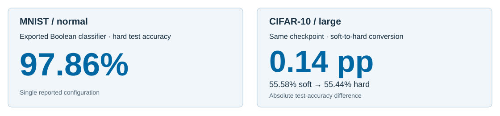

# DLGN: Differentiable Logic-Gate Networks

**English** | [简体中文](README.zh-CN.md)

**Train with differentiable operators. Export a discrete Boolean circuit.**

A PyTorch research reproduction of [Deep Differentiable Logic Gate Networks (NeurIPS 2022)](https://arxiv.org/abs/2210.08277). This repository focuses on a transparent **soft-training → hard-logic** path and paired evaluation of the resulting classifier. The underlying differentiable-logic method belongs to the cited authors; see [method attribution](REFERENCE_NOTES.md).

## Abstract

Boolean logic offers an interpretable, discrete computational representation for classification, yet optimizing gate choices end to end requires differentiable training. This implementation builds a sparse classifier with fixed two-input wiring and trainable mixtures of the 16 Boolean operators, then exports the selected operator at every gate for hard inference. Crucially, training-time and exported predictions are evaluated on corresponding checkpoints. The reported MNIST configuration achieves **97.86% hard test accuracy**, while the CIFAR-10 large configuration reaches **55.44% hard test accuracy** with a **0.14 percentage-point soft-to-hard gap**. These results demonstrate the practical continuity from differentiable gate learning to discrete execution within a reproducible PyTorch workflow.

## Contributions

1. **A reproducible differentiable-to-discrete pipeline.** Fixed sparse connectivity, trainable Boolean operator logits, checkpoint selection, and exact argmax gate export are implemented as inspectable modules.
2. **Paired soft/hard assessment.** Every reported comparison evaluates a soft classifier against its corresponding exported gate network, directly measuring conversion fidelity.
3. **Reusable logic-gate components.** Dataset embeddings, operator evaluation, sparse layers, class-group readout, and hard inference form a compact starting point for spatial [Conv-DLGN](https://github.com/13710833172/Conv-DLGN) and temporal [Logic-SNN](https://github.com/13710833172/Logic-SNN) variants.

## Methodology

DLGN learns **which logic operator each node uses** while keeping its two input connections fixed.

*Figure 1. DLGN training and inference. (a) Soft nodes learn mixtures of 16 real-valued logic operators through backpropagation. (b) Per-node argmax selects one Boolean operator for hard inference; wiring and class-group readout are preserved. (c) The complete operator library, its real-valued extensions, and truth bits in input order 00, 01, 10, 11. Network size and predictions are illustrative.*

[View the full-size SVG](docs/figures/DLGN_overview_redesign.svg)

For inputs $a,b$, a differentiable gate uses the continuous extension $f_k$ of each of the 16 two-input Boolean functions:

$
p_k = \frac{e^{\theta_k}}{\sum_{j=0}^{15} e^{\theta_j}},
\qquad
g_{\theta}(a,b) = \sum_{k=0}^{15} p_k f_k(a,b).
$

$
k^{*} = \arg\max_{0 \leq k \leq 15} \theta_k.
$

Here $p_k$ is the normalized weight of Boolean operator $f_k$; hard export selects the highest-logit operator $k^{*}$.

**Architecture.** Each gate reads two fixed, seed-controlled inputs. Stacked [logic layers](src/models/logic_net.py) transform flattened or threshold-embedded images; the [class-group readout](src/utils/output_grouping.py) aggregates output units into class scores.

**Optimization and export.** The [soft gate layer](src/models/logic_layer.py) learns 16 logits per gate using backpropagation. [Hard export](src/discretize.py) retains the stored connectivity and assigns operator $k^*$ to each gate. The [Boolean operator implementation](src/ops/logic_ops.py) is shared across the research workflow.

## Experiments

**Primary question: how closely does the exported Boolean classifier track the learned soft model?** The most informative comparison pairs soft and hard test accuracy on the *same* selected configuration.

*Figure 2. Two complementary indicators: classification accuracy of an exported MNIST model and conversion fidelity on a CIFAR-10 large configuration. Figures correspond to the rows in Table 1.*

| Dataset / configuration | Soft accuracy ↑ | Hard accuracy ↑ | Soft − hard (pp) ↓ |
|:--|--:|--:|--:|
| MNIST / normal | 98.15% | **97.86%** | 0.29 |
| CIFAR-10 / small | 48.80% | 47.91% | 0.89 |
| CIFAR-10 / large | 55.58% | **55.44%** | **0.14** |

*Table 1. Reported single-run test observations from corresponding soft and exported checkpoints. Configuration and input protocol vary by row; this table assesses export within each model.*

**Finding.** The CIFAR-10 large configuration retains **99.75% of its soft accuracy in relative terms** (55.44 / 55.58), corresponding to a **0.14 pp** absolute conversion difference. MNIST establishes a second high-accuracy hard-logic operating point at **97.86%**.

**Evaluation protocol.** The training pipeline selects checkpoints by validation soft accuracy and then evaluates soft/hard inference on the held-out test split. Reported entries are individual configurations. The MNIST implementation trains on continuous flattened pixels and evaluates thresholded pixels; CIFAR-10 employs configuration-specific threshold embeddings. See [data loaders](src/data/) and [configuration files](configs/) for the precise implemented paths. Accuracy values above are documented historical observations; the repository does not ship the corresponding raw run directories or pretrained weights.

## Reproduce the pipeline

~~~bash
python3 -m venv .venv
source .venv/bin/activate
pip install -r requirements.txt

# Train a complete configured run
python src/train.py --config configs/mnist_normal_paper.yaml

# Evaluate and discretize a checkpoint produced by that run
python src/evaluate.py --checkpoint path/to/checkpoint.pt
python src/discretize.py --checkpoint path/to/checkpoint.pt

# Core logic/operator tests
python -m pytest tests/test_logic_ops.py tests/test_connectivity.py tests/test_output_grouping.py -v
~~~

The commands provide an executable path through model training, evaluation, and operator export. Local datasets and run artifacts are created or supplied separately.

## Repository map

| Location | Role |
|:--|:--|
| [src/models/](src/models/) · [src/ops/](src/ops/) | Soft and hard gate networks; Boolean operator algebra |
| [src/data/](src/data/) | MNIST/CIFAR-10 loaders and encodings |
| [configs/](configs/) | Architecture and training profiles |
| [scripts/](scripts/) | Feasibility checks and figure generation |
| [REFERENCE_NOTES.md](REFERENCE_NOTES.md) | Original-method attribution and reproduction scope |

## Takeaway

**A learned sparse logic classifier can be exported as explicit Boolean gate choices with directly measurable soft-to-hard agreement.** The CIFAR-10 large result illustrates this with a **0.14 pp** conversion difference.
